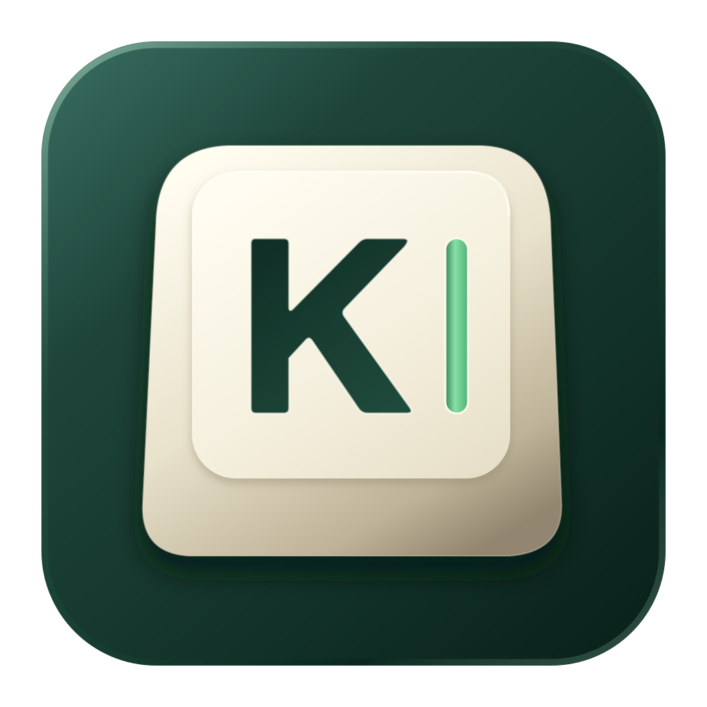
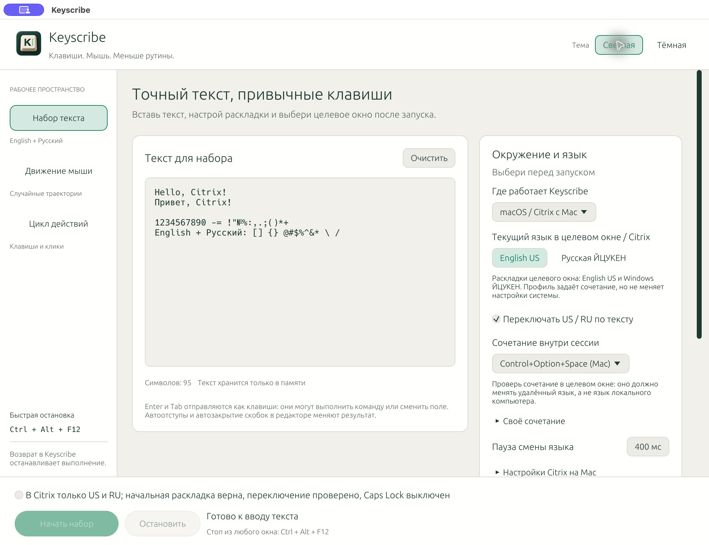
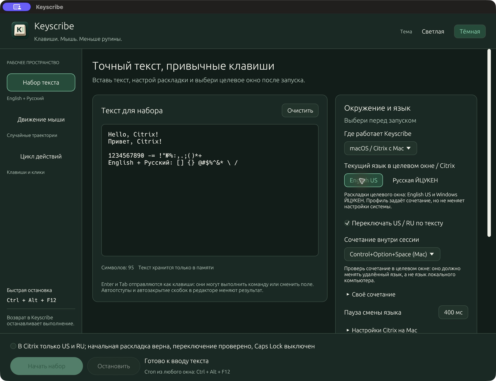
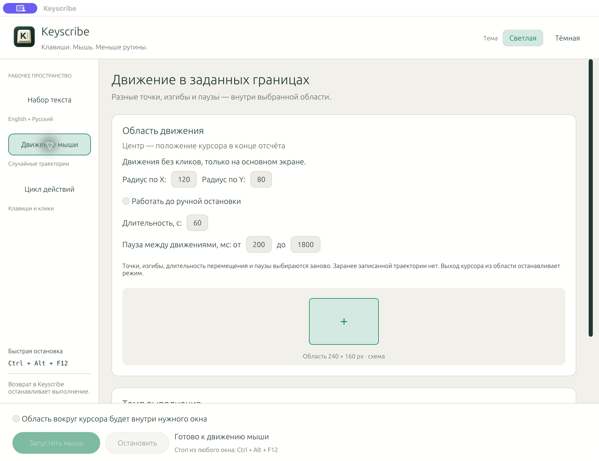
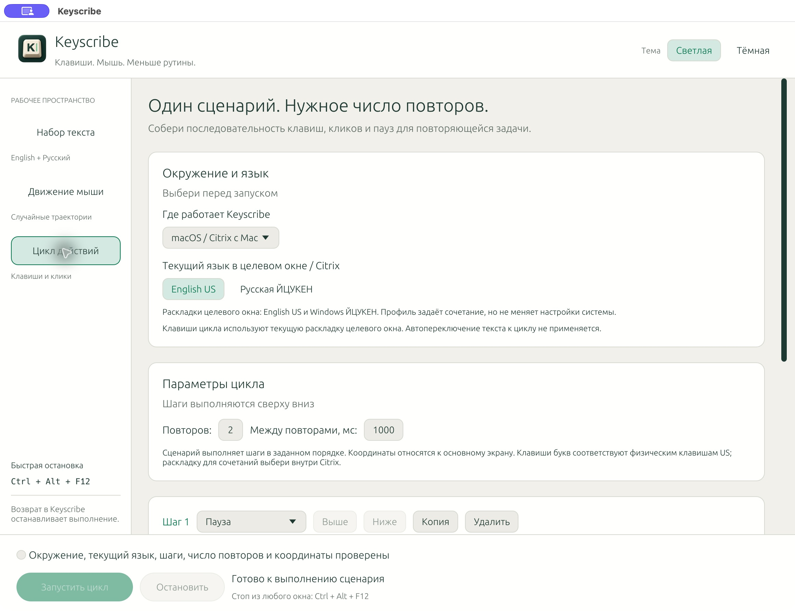

# Keyscribe



[English](README.md) · [Русский](README.ru.md) · [Español](README.es.md)


Текст, мышь и циклы действий · Русский и английский вперемешку · macOS и Windows

<details>
<summary>Содержание</summary>

[Возможности](#возможности) · [Технологии](#технологии) · [Использование](#использование) · [Случайные движения мыши](#случайные-движения-мыши) · [Повторяемые циклы действий](#повторяемые-циклы-действий) · [Настройки Citrix на Mac](#настройки-citrix-на-mac) · [Команды Make](#команды-make) · [macOS M1 и новее](#macos-m1-и-новее) · [Windows x64](#windows-x64) · [Разработка и проверки](#разработка-и-проверки) · [Автор](#автор) · [Лицензия](#лицензия)

</details>



**Вставь текст здесь. Набери его в нужном окне.** Keyscribe преобразует текст
в физические нажатия клавиш с задержками. Снимок сделан в текущем приложении
на macOS с демонстрационным текстом; набор в удалённую сессию для кадра не запускался.
Интерфейс приложения сейчас на русском; документация доступна на трёх языках.

Переключай **Светлая / Тёмная** в верхней панели. В широком окне текст и настройки стоят рядом, в узком — друг под другом. Выбор темы действует до закрытия приложения.

<details>
<summary>Тёмная тема</summary>



</details>

<details>
<summary>Случайное движение мыши</summary>



</details>

<details>
<summary>Редактор повторяемого цикла</summary>



</details>

## Возможности

| Возможность        | Поведение                                                                              |
| ------------------ | -------------------------------------------------------------------------------------- |
| Смешанный текст    | English US и русская ЙЦУКЕН, оба регистра, цифры, печатные ASCII-символы и `№`         |
| Переключение языка | Alt+Shift, Ctrl+Shift, Win+Space или своё сочетание                                    |
| Переносы и отступы | Физические Enter и Tab, сохранение пробелов                                            |
| Скорость           | Отдельные настройки отсчёта, удержания, паузы между клавишами и после смены языка      |
| Проверка текста    | Весь ввод проверяется до отправки первой клавиши                                       |
| Остановка          | Ctrl+Alt+F12, кнопка «Остановить» или возврат в окно Keyscribe                               |
| Локальная работа   | Текст остаётся в памяти; сервер и установка приложения в Citrix не нужны               |
| Случайная мышь     | Разные точки, изгибы, время перемещения и паузы в ограниченной области                 |
| Циклы действий     | Клавиши, сочетания, клики, перемещения и паузы; порядок и число повторов настраиваются |
| Оформление | Светлая кремовая и тёмно-зелёная темы; навигация и кнопки запуска всегда видны |

## Технологии

| Компонент            | Реализация                                                    |
| -------------------- | ------------------------------------------------------------- |
| Язык                 | Rust 2021, минимальная версия компилятора в Cargo.toml — 1.88 |
| Интерфейс            | egui / eframe 0.33, OpenGL через glow                         |
| События клавиатуры   | Enigo 0.6, физические коды клавиш                             |
| Глобальная остановка | global-hotkey 0.9                                             |
| Выполнение ввода     | Отдельный поток, отменяемые ожидания, освобождение клавиш     |
| Сборка               | Cargo, зафиксированный Cargo.lock, скрипты macOS и Windows    |

Небольшое локальное приложение на Rust для Windows x64 и macOS Apple Silicon
(M1 и новее). UI — egui/eframe; физические клавиши — Enigo. Отдельного сервера,
JavaScript и доступа к сети во время работы не требуется.
Текст, сценарии и настройки хранятся только в памяти и сбрасываются при закрытии;
автосохранение на диск не выполняется.

## Использование

Если пропущен обязательный пункт, нажатие «Начать набор» или другой кнопки
запуска прокручивает к нему экран: закруглённая красная рамка плавно мигает три
раза, затем остаётся до исправления. Подсказка объясняет нужное действие и
переходит к следующему пропущенному пункту. После «Продолжить» в окне доступа
подсвечивается следующий шаг настройки. Заполнение полей само не запускает ввод.

1. Вставь текст в Keyscribe обычным Cmd+V / Ctrl+V.
2. Выбери **окружение, где работает Keyscribe**: macOS / Citrix с Mac или
   Windows / Citrix с Windows. Профиль macOS предлагает **Control+Option+Space**,
   Windows — **Win+Space**. Также доступны **Ctrl+Win+Space**, Alt+Shift,
   Ctrl+Shift и своё сочетание. Это настраиваемые пресеты: проверь, какой из них
   переключает язык именно внутри твоей сессии, а не на локальном компьютере.
   Затем укажи **текущую раскладку удалённой Windows**: English US или стандартную
   русскую ЙЦУКЕН. Автопереключение позволяет набирать их вперемешку, включая
   `№`, оба регистра, все печатные ASCII-символы и переносы строк.
   Своё сочетание можно собрать из Ctrl/Alt/Shift/Win с Space, цифрой или F1–F12.
   Можно отключить автопереключение и работать в одной раскладке.
3. В Citrix выбери ту же раскладку, выключи Caps Lock. В редакторе отключи
   автоматические отступы, автозакрытие скобок и замену кавычек.
4. Подтверди раскладку галочкой, нажми «Начать набор» и за время отсчёта кликни
   в нужное поле Citrix. Не удерживай модификаторы и не переключай окна во время
   набора. По умолчанию до старта 5 секунд, удержание 25 мс, пауза 100 мс,
   после смены раскладки — 400 мс. Последнюю паузу можно увеличить отдельно.
5. Для остановки нажми **Ctrl+Alt+F12** (на Mac: Control+Option+F12; если F12
   управляет громкостью, также удерживай Fn). Возврат в Keyscribe тоже
   останавливает набор. Перед продолжением сверь уже набранный фрагмент:
   автоматического возобновления или повтора нет.

Для автопереключения в удалённой сессии должны быть **ровно две раскладки**:
English US и русская ЙЦУКЕН. Настроенное сочетание должно переключать их друг
на друга, а не всегда включать один фиксированный язык. Программа сохраняет
текущую раскладку для общих символов и переключает её только при необходимости.
После завершения или остановки раскладка остаётся в последнем состоянии:
перед новым запуском снова проверь и укажи начальную раскладку.
Окружение и язык изначально не выбраны: без них набор и цикл не запускаются.
После выполнения, остановки или ошибки запуска выбор языка сбрасывается;
его нужно указать заново. При смене окружения язык тоже сбрасывается, а сочетание
заменяется пресетом профиля. Окружение не меняет системные настройки и не добавляет
поддержку русской раскладки macOS: целевая русская раскладка остаётся Windows ЙЦУКЕН.
Настройки действуют до закрытия приложения.

На Mac Win отправляется как правый Command. Для Win+Space в Citrix должна
быть включена опция передачи Windows logo key через Command (right).
Проверь, что сочетание меняет язык именно в удалённой сессии, а не на локальном
компьютере. Обработка сочетаний описана в документации
[Citrix для Mac](https://docs.citrix.com/us/en/citrix-workspace-app-for-mac/devices/keyboard.html),
[Windows — переключение языка](https://support.microsoft.com/en-us/windows/hardware/input-devices/manage-the-language-and-keyboard-input-layout-settings-in-windows).

Каждый перенос строки становится реальным Enter, в том числе последний.
CRLF и одиночный CR нормализуются в один Enter. Tab остаётся реальным Tab:
он может менять поле или запускать автодополнение. Для отступов используй пробелы,
если целевой редактор обрабатывает Tab иначе. Нет автоматического добавления Enter.

Весь текст проверяется **до первого нажатия**: неподдерживаемые символы
(например, emoji, неразрывный пробел или буквы других алфавитов) вызывают ошибку
с номером строки и столбца. Счётчик показывает отправленные нажатия, а не
подтверждение получения текста удалённой стороной. Клавиши переключения языка
в этот счётчик не входят. Поддержка произвольного Unicode не заявляется:
символы вне US/русской ЙЦУКЕН отклоняются заранее, без подмены.

Текст хранится в памяти процесса. Приложение не сохраняет его в файлы,
не записывает в логи, не отправляет по сети и не использует вставку в Citrix.
Буфер обмена читает UI только для вставки в локальное поле.

## Случайные движения мыши

Открой вкладку **Движение мыши**. Укажи радиусы по X/Y (5–2000 координатных
единиц), диапазон пауз и длительность. По умолчанию — радиусы 120/80, паузы
200–1800 мс и таймер 60 секунд. Можно выбрать работу до ручной остановки.

После обратного отсчёта область фиксируется вокруг текущего курсора, поэтому
до окончания отсчёта наведи его на нужную область целевого окна. Поддерживается
основной экран; область обрезается по его границам. Режим не нажимает кнопки мыши.
Ручной выход курсора из области останавливает выполнение при проверке перед
следующим перемещением; возврат фокуса в Keyscribe также останавливает режим.

Генератор случайных данных ОС выбирает новые цели, две контрольные точки кривой,
время движения (250–1400 мс) и паузу. Заранее записанной траектории нет;
случайность не означает гарантированную уникальность всех движений.

## Повторяемые циклы действий

Открой вкладку **Цикл действий** и добавь шаги:

- **Клавиши**: Enter, Tab, Escape, Backspace, Delete, стрелки, Home/End,
  PageUp/PageDown, Space, A–Z, цифры и F1–F12. Можно добавить Ctrl/Alt/Shift/Win.
- **Клик**: X/Y основного экрана, левая/правая/средняя кнопка, обычный или двойной клик.
- **Движение мыши**: переход к заданным координатам.
- **Пауза**: от 10 мс до часа.

Шаги можно перемещать выше/ниже, копировать и удалять. Допустимо до 200 шагов
и 1–10000 повторов, с отдельной паузой между повторами. Для захвата координат
выбери нужный шаг и нажми «Взять координаты: Ctrl+Alt+F11», затем наведи курсор
на нужную точку в целевом окне и нажми это сочетание. Альтернатива — кнопка
**«Захват через 3 с»**: наведи курсор до окончания таймера. Ввод X/Y вручную тоже доступен.
На Mac для физических F-клавиш может требоваться Fn.

Перед запуском проверь сценарий на одном повторе, затем выставь нужное число.
Приложение проверяет все шаги и координаты до первого действия. Ctrl+Alt+F11/F12
зарезервированы приложением. Буквы в цикле — физические клавиши US: они зависят
от выбранной внутри целевого окна раскладки; автопереключение текста к ним не применяется.

Все режимы используют общий отсчёт и остановку **Ctrl+Alt+F12**, кнопку «Остановить»
и остановку при возврате в Keyscribe; одновременно работает один режим.
После ошибки или отмены нет автоматического повтора шага. Счётчик отражает
отправленные действия, а не подтверждение закрытия задачи. Сценарий не распознаёт
содержимое экрана и не ждёт результата операции: нужные задержки задаются шагами.
Настройки и сценарий пока хранятся только до закрытия приложения.

## Настройки Citrix на Mac

Физические коды требуют **Keyboard input mode → Scancode**. В Citrix Workspace
для Mac это находится в настройках Keyboard. Для этого режима Citrix рекомендует
синхронизацию раскладки **Don't sync**; нужную раскладку выбирай внутри сессии.
После изменения настроек переподключись к сессии. В Automatic клиент может
выбрать Unicode, что меняет обработку раскладки.

Источник: [Citrix — Keyboard](https://docs.citrix.com/us/en/citrix-workspace-app-for-mac/devices/keyboard.html).
Для браузерного Citrix и других версий расположение настроек может отличаться.

Перед длинным набором проверь короткий пример в пустом текстовом редакторе
внутри Citrix: [смешанный пример](samples/mixed.txt), [US](samples/us.txt)
или [русский](samples/ru.txt). Проверь
регистр, знаки, пробелы, Enter и аварийную остановку. Если теряются символы,
увеличь паузу и время удержания. Для смешанного примера проверь также смену
языка; после него язык может отличаться от начального.

**Точность в конкретной сессии Citrix не подтверждена.** Приложение не читает
удалённый экран и не может обнаружить потерянные события, неверную раскладку,
смену фокуса на другое чужое окно или преобразования редактора. Глобальная
остановка тоже требует проверки в твоём полноэкранном сеансе Citrix.

## Команды Make

Выполняй команды из каталога `keyscribe/`. Нужны GNU Make и инструменты сборки
для платформы, перечисленные ниже, доступные в `PATH`. На Windows GNU Make
устанавливается отдельно; используй окружение сборки MSVC. Для упаковки Makefile
вызывает Windows PowerShell на Windows и shell-скрипт на macOS.

| Команда | Действие |
| --- | --- |
| `make` или `make dev` | Собрать и запустить версию для разработки |
| `make build` | Собрать готовое приложение и ZIP для текущей ОС |
| `make run` | Открыть готовую сборку без пересборки |
| `make start` | Собрать готовое приложение, затем открыть его |
| `make check` | Проверить форматирование, запустить Clippy и тесты |
| `make test` | Запустить тесты |
| `make lint` | Запустить Clippy; предупреждения считаются ошибками |
| `make fmt` | Отформатировать Rust-код |
| `make fmt-check` | Проверить форматирование без изменения файлов |
| `make help` | Показать список команд |

Если сборки нет, `make run` сообщит об этом. На macOS открывается
`dist/Keyscribe.app`, на Windows — `dist/windows-x64/Keyscribe.exe`.
Для сборки и открытия готового приложения одной командой используй `make start`.
Перед запуском закрой другой экземпляр Keyscribe: он может уже занимать глобальные
сочетания. Открытие приложения само по себе не запускает набор или движение мыши.

## macOS M1 и новее

Нужны Rust (rustup) и Xcode Command Line Tools. Сборка локального `.app`:

```sh
sh scripts/build-macos.sh
open dist/Keyscribe.app
```

Результат: `dist/Keyscribe.app` и `dist/Keyscribe-macos-arm64.zip`.
Без доступа macOS приложение показывает блокирующее окно с состоянием
**Универсального доступа / Accessibility** и подключения движка ввода Enigo
без отправки событий. Дополнительное разрешение на отправку событий не запрашивается.
В нём доступны «Запросить доступ», «Открыть настройки», «Проверить ещё раз»
и «Показать в Finder» для текущей копии приложения. Разреши Keyscribe в
«Системные настройки → Конфиденциальность и безопасность → Универсальный доступ».
Статус проверяется автоматически, при возврате из настроек и перед запуском.
«Продолжить» проверяет доступ самой macOS; если его нет, окно остаётся открытым
и подсвечивает блок разрешений;
набор и движение мыши автоматически не начинаются. Окно можно повторно открыть
кнопкой «Доступ macOS» в шапке. При отзыве доступа выполнение останавливается.
macOS может не показать повторный системный запрос: тогда открой настройки.

Перед пересборкой закрой Keyscribe: скрипт сборки остановится, если приложение
ещё работает. Если после перемещения или пересборки галочка включена, но доступа
нет, открой в окне доступа «Сбросить старое разрешение…» и подтверди сброс.
Приложение регистрирует свой текущий путь в LaunchServices и выполняет только
`/usr/bin/tccutil reset Accessibility local.keyscribe.desktop`. Права других
приложений не меняются. Затем Keyscribe повторяет запрос и открывает настройки.
Включи доступ для текущей копии и перезапусти её. Если записи нет, добавь `.app`
через «+»; путь и кнопка Finder есть в диалоге. Альтернатива — вручную удалить
старую запись и добавить текущую. Keyscribe не выдаёт себе права и не сбрасывает
их автоматически: нужен явный запрос и подтверждение пользователя.
При `cargo run` разрешение может относиться к терминалу или бинарному файлу;
для постоянного использования запускай `.app` из одного и того же места.
По умолчанию сборка имеет ad hoc подпись: её требование доверия привязано к хешу
и может измениться после пересборки. При наличии постоянного сертификата можно
использовать `KEYSCRIBE_SIGNING_IDENTITY="имя сертификата" make build`.
При изменении сертификата разрешение тоже может потребоваться заново.
Apple notarization не выполняется. Источники:
[Apple: запрос Accessibility](https://developer.apple.com/documentation/applicationservices/1459186-axisprocesstrustedwithoptions),
[Apple: идентичность подписи](https://developer.apple.com/documentation/technotes/tn3127-inside-code-signing-requirements).

## Windows x64

Собирать на Windows с Rust stable и Visual Studio Build Tools, компонент
**Desktop development with C++** / Windows SDK:

```powershell
powershell -ExecutionPolicy Bypass -File scripts/build-windows.ps1
```

Иконка `.exe` встраивается через `build.rs` и [ICON resource](https://learn.microsoft.com/en-us/windows/win32/menurc/icon-resource).
Запускай сборку из Developer PowerShell for Visual Studio: `rc.exe` из Windows SDK
должен быть в `PATH`. Проверка Windows-кода с macOS не компилирует этот ресурс.

Результат: `dist/windows-x64/Keyscribe.exe` и `dist/Keyscribe-windows-x64.zip`.
Установка приложения на удалённый рабочий стол не нужна: запускай на локальном
компьютере рядом с Citrix. Ограничения Windows на ввод в процессы с повышенными
правами описаны в [SendInput](https://learn.microsoft.com/en-us/windows/win32/api/winuser/nf-winuser-sendinput).

## Разработка и проверки

Иконка хранится как векторный исходник [keyscribe.svg](assets/icons/keyscribe.svg),
без встроенного PNG и зависимости от системных шрифтов. Это векторная версия
прежнего знака K с курсором, без растровой текстуры. Производные `keyscribe-128.png`,
`keyscribe.icns` и `keyscribe.ico` нужны интерфейсу и платформенной упаковке.
Для их обновления используй `node scripts/generate-icons.mjs /путь/к/node_modules/sharp`;
инструмент требует Node.js и отдельно установленный `sharp` (проверено с 0.35.5).
Обычная сборка и запуск приложения не требуют Node.js. Файлы `.DS_Store`,
Finder `Icon` и `Icon` с завершающим CR игнорируются в Git на любой глубине и
исключаются из упаковки; локальный файл иконки папки удалять не нужно.

Команды выполняются из корня **исходного проекта** с установленным Rust:

```sh
cargo run --locked
cargo fmt --check
cargo test --locked
cargo clippy --locked --all-targets --all-features -- -D warnings
```

Структура: `src/keyboard.rs` валидирует текст и формирует последовательность;
`src/playback.rs` отвечает за освобождение клавиш и модификаторов сочетаний;
`src/shortcut.rs` задаёт настраиваемое переключение языка; `src/desktop.rs` выполняет
набор в отдельном потоке; `src/main.rs` содержит UI и глобальную остановку.
`src/cycle.rs` выполняет цикл шагов, `src/motion.rs` строит случайные траектории,
`src/automation_ui.rs` содержит редактор сценария и настройки мыши.
`src/workspace_ui.rs` задаёт компоновку рабочего окна и закреплённые кнопки,
`src/appearance.rs` — светлую и тёмную палитры, типографику и стили элементов.
Формат физических кодов: [Enigo Keyboard::raw](https://docs.rs/enigo/0.6.1/enigo/trait.Keyboard.html#tymethod.raw).
Зависимости зафиксированы в `Cargo.lock`.

Сборка macOS arm64 создана локально. Для Windows подготовлен скрипт и выполнена
проверка компиляции для x64; сборка и запуск `.exe` на Windows не проверены.
Это не подтверждает получение клавиш конкретной удалённой сессией Citrix.

## Автор

Denis Gutsuliak · [d9911.org](https://d9911.org).

## Лицензия

Полные условия приведены в [LICENSE](LICENSE).

[](LICENSE)
